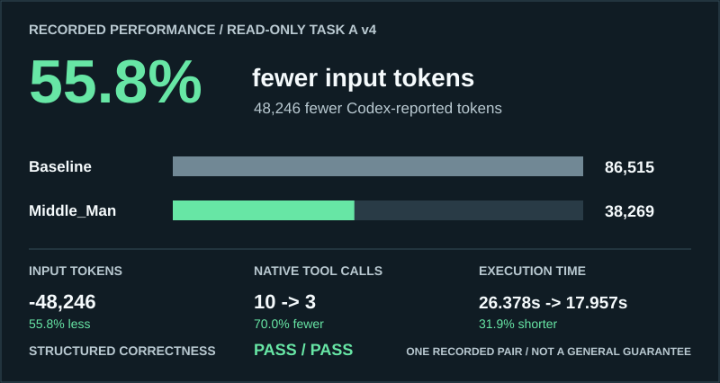

# Middle_Man

Local code navigation for agents, plus a deterministic LLM-serving Lab.

Middle_Man contains two independent systems:

- **Agent Gateway** indexes a repository locally, finds relevant files and symbols,
  and builds bounded, source-verified Context Packs. It offers a local MCP server
  and conservative Codex routing.
- **Lab** simulates LLM serving with token-budgeted scheduling, continuous
  batching, KV blocks, preemption, prefix caching, and repeatable benchmarks.
  Lab timings are simulated, not GPU measurements.

The local Gateway neither calls a model nor requires a provider API key. A live
Codex run is a separate, explicitly confirmed action.

## What It Does

- Finds likely entry points using paths, symbols, imports, tests, and Git changes,
  with reasons for each match.
- Supplies scoped, redacted source excerpts through Context Packs and the optional
  five-tool MCP interface. Agents can request more context when needed.
- Offers source-free path and symbol hints for substantial read-only Codex tasks,
  so an agent can navigate to relevant code without an initial source dump.
- Provides local output compaction, factual Project Memory, and Session Handoff
  for continuing repository work.
- Runs deterministic Lab simulations and benchmarks without a model, GPU, or
  external service.

MCP serves verified excerpts on request; the featured experiment instead used
an offline locator with no source excerpts or Middle_Man MCP calls. These are
different delivery modes, not interchangeable token-saving results.

The Gateway's local context-size estimates are not Codex-reported usage. No
Gateway mode guarantees provider-token savings. Source redaction is best effort;
review repository content and client access before sending context externally.

## Recorded Performance



| Metric | Codex alone | With Middle_Man | Change |
| --- | ---: | ---: | ---: |
| Input tokens | 86,515 | 38,269 | -55.8% |
| Cached input tokens | 57,728 | 14,336 | -75.2% |
| Output tokens | 713 | 628 | -11.9% |
| Native tool calls | 10 | 3 | -70.0% |
| Execution time | 26.38s | 17.96s | -31.9% |
| Correctness | PASS | PASS | Maintained |

This is **one recorded Task A v4 read-only offline-locator experiment**, not an
overall result. Both runs passed the structured correctness check. Token counts
are Codex-reported; time and native calls are observed process metrics.


The other frozen pairs show mixed results, including higher input with historical
MCP delivery and edit-task hints. The timed-out edit run has no optimized token
count. Current AUTO bypasses workspace-write tasks; historical full-locator edit
regressions are **not** current AUTO behavior. These observations do not establish
universal token, billing, or plan-usage savings.

See the [full performance report](docs/CODEX_PERFORMANCE.md) for all six pairs,
cached and output usage, file reads, duration, correctness, and source-hash
provenance.

## Quick Start

The [v0.1.0a1 GitHub prerelease](https://github.com/OloaneShark/Middle_Man/releases/tag/v0.1.0a1)
includes a wheel. The workflow below was verified on Windows with Python 3.14.
Run it from a directory containing the downloaded wheel, with the virtual
environment outside the repository you will inspect:

```powershell
python -m venv .venv
.\.venv\Scripts\python.exe -m pip install ".\middle_man-0.1.0a1-py3-none-any.whl[mcp]"
.\.venv\Scripts\middle-man.exe index --repo C:\path\to\project
.\.venv\Scripts\middle-man.exe context find "request scheduling" --repo C:\path\to\project
```

`index` writes local metadata under the target repository's Git-ignored
`.middle_man_cache/`; the search command needs no Codex login or model call. The
wheel works without a Middle_Man source checkout. The `mcp` extra enables the
local stdio server; [Codex setup](docs/CODEX_SETUP.md) covers registration and
the five-tool `codex-core` profile.

To try the separate Lab in the same environment:

```powershell
.\.venv\Scripts\middle-man.exe simulate
.\.venv\Scripts\middle-man.exe benchmark --list
```

For Codex, `middle-man codex run` can preview local routing with `--dry-run`.
Confirmed execution uses the installed Codex CLI and may transmit repository
content to its external service; see [Codex integration](docs/CODEX_INTEGRATION.md)
before enabling it. Live experimental inference remains limited by unresolved
host-filesystem isolation concerns. Read-only sandbox mode alone is not proof of
filesystem confinement.

## Documentation

- [Gateway and Codex MCP setup](docs/CODEX_SETUP.md)
- [Codex production integration and isolation](docs/CODEX_INTEGRATION.md)
- [Full recorded performance report](docs/CODEX_PERFORMANCE.md)
- [Historical Codex benchmark methodology and results](docs/CODEX_BENCHMARKS.md)
- [Lab and Gateway architecture](docs/ARCHITECTURE.md)
- [Claude integration status](docs/CLAUDE_INTEGRATION.md)
- [Alpha release notes](docs/RELEASE_NOTES_0.1.0a1.md)
- [Contributing](CONTRIBUTING.md)
