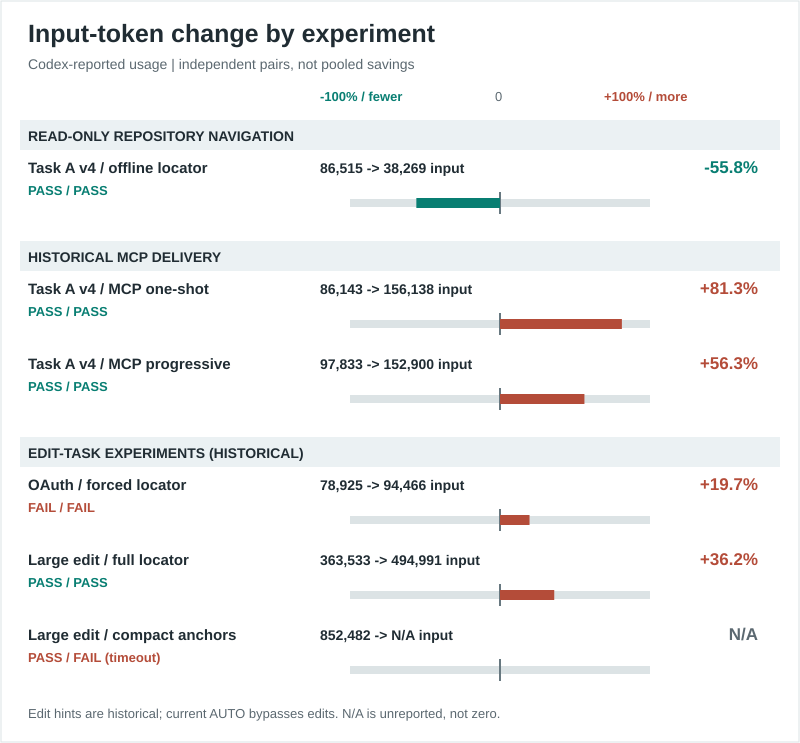
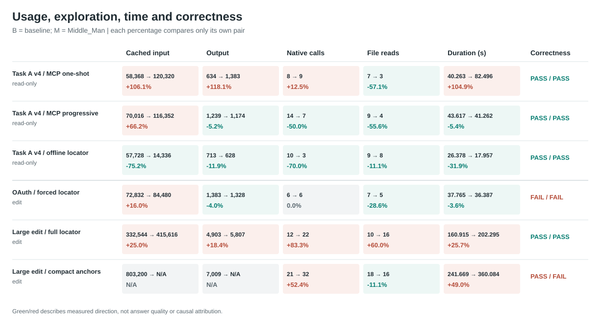

# Recorded Codex performance

These are six **independent, frozen Phase 22 pairs**, not a pooled benchmark. Each percentage is `(Middle_Man - baseline) / baseline` within that pair. Negative usage or time means less; it does not by itself mean a better answer. The data is a [sanitized, source-hashed snapshot](data/codex_performance.json) extracted from local ignored `result.json` files. Their run IDs and SHA-256 hashes are retained in that snapshot. Sanitized `turn.completed` events independently matched every available provider-usage record.





## Provider-reported usage

Values are baseline -> Middle_Man. Cached input is a **subset** of input, not an additional token count. Output is the recorded Codex output-token field. `N/A` means not reported, not zero. Each row links to its frozen run ID in the tracked [data](data/codex_performance.json); the underlying full results remain local and ignored.

| Frozen pair | Work / delivery | Input tokens (change) | Cached input | Output tokens | Structured correctness |
| --- | --- | ---: | ---: | ---: | --- |
| Task A v4 / MCP one-shot | Read-only / persistent MCP | 86,143 -> 156,138 (+81.3%) | 58,368 -> 120,320 | 634 -> 1,383 | PASS / PASS |
| Task A v4 / MCP progressive | Read-only / persistent MCP | 97,833 -> 152,900 (+56.3%) | 70,016 -> 116,352 | 1,239 -> 1,174 | PASS / PASS |
| Task A v4 / offline locator | Read-only / source-free prompt hint | 86,515 -> 38,269 (-55.8%) | 57,728 -> 14,336 | 713 -> 628 | PASS / PASS |
| OAuth / forced locator | Edit / source-free prompt hint | 78,925 -> 94,466 (+19.7%) | 72,832 -> 84,480 | 1,383 -> 1,328 | FAIL / FAIL |
| Large edit / full locator | Edit / former size-only AUTO hint | 363,533 -> 494,991 (+36.2%) | 332,544 -> 415,616 | 4,903 -> 5,807 | PASS / PASS |
| Large edit / compact anchors | Edit / research-only prompt hint | 852,482 -> N/A (N/A) | 803,200 -> N/A | 7,009 -> N/A | PASS / FAIL (optimized timeout) |

## Exploration and time

Native calls and explicit file reads are **observed parser counts**, not a complete filesystem-access trace. A command can read multiple files. MCP calls are separate from native calls. Duration is elapsed process time, not simulated Lab throughput.

| Frozen pair | Native calls (change) | Explicit reads (change) | Elapsed seconds (change) | MCP calls B -> M | Local heuristic payload estimate |
| --- | ---: | ---: | ---: | ---: | --- |
| Task A v4 / MCP one-shot | 8 -> 9 (+12.5%) | 7 -> 3 (-57.1%) | 40.263 -> 82.496 (+104.9%) | 0 -> 1 | 7,184 initial MCP result tokens |
| Task A v4 / MCP progressive | 14 -> 7 (-50.0%) | 9 -> 4 (-55.6%) | 43.617 -> 41.262 (-5.4%) | 0 -> 1 | 5,687 initial MCP result tokens |
| Task A v4 / offline locator | 10 -> 3 (-70.0%) | 9 -> 8 (-11.1%) | 26.378 -> 17.957 (-31.9%) | 0 -> 0 | 159 locator-text tokens |
| OAuth / forced locator | 6 -> 6 (0.0%) | 7 -> 5 (-28.6%) | 37.765 -> 36.387 (-3.6%) | 0 -> 0 | 44 locator-text tokens |
| Large edit / full locator | 12 -> 22 (+83.3%) | 10 -> 16 (+60.0%) | 160.915 -> 202.295 (+25.7%) | 0 -> 0 | 214 locator-text tokens |
| Large edit / compact anchors | 21 -> 32 (+52.4%) | 18 -> 16 (-11.1%) | 241.669 -> 360.084 (+49.0%) | 0 -> 0 | 66 anchor-text tokens |

The local payload estimates use Middle_Man's bytes/4 heuristic and measure **different surfaces** (MCP result versus offline hint text). They are not Codex usage and must not be subtracted from provider tokens. The Task A offline pair is the one observed input saving with both answers passing. Both MCP delivery pairs passed but increased reported input, even where native reads fell. The large-edit full locator was correct on both sides but increased input, calls, reads, and time. Current AUTO bypasses edit tasks; that full-locator row is **historical**, not the current AUTO policy. OAuth failed the same ambiguous TTL/skew acceptance contract on both sides; the locator is not assigned that failure. The compact-anchor optimized run timed out, so no optimized token delta exists and the timeout's cause is unproven.

The [Phase 22 benchmark history](CODEX_BENCHMARKS.md) also documents earlier Task A v1/v2 MCP regressions, invalid infrastructure attempts, and Task A v3 correctness failures. Their exact original result files are not all available in this checkout, so they are **not plotted or silently merged** with the six source-hashed records above. No upload edit A/B or general provider-token saving is established. Different prompts, delivery methods, and executions cannot be aggregated into a universal percentage or billing/quota claim.

## Reproduce

From a source checkout, regenerate the three static SVGs with no model or network call:

```powershell
python -m scripts.render_codex_performance
python -m scripts.render_codex_performance --check
```

If the ignored original Phase 22 result files are present under `.middle_man_cache/codex_benchmarks/`, `--extract --check` verifies every source SHA-256 and the committed sanitized data before checking the figures. To refresh the snapshot from those **exact** frozen records, run `--extract` without `--check`; changed source bytes are rejected. The snapshot contains only numeric metrics, correctness booleans, run IDs, quality gates, delivery labels, and source hashes. It excludes raw prompts, source excerpts, model answers, and command text. Neither this report nor the charts modify the existing alpha tag or historical artifacts.
